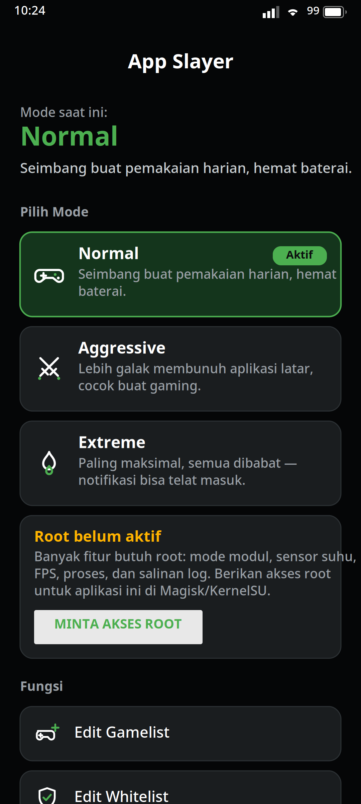
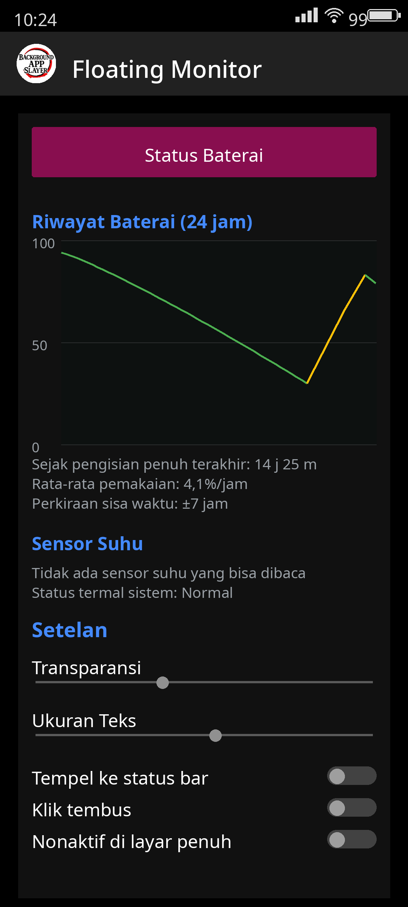
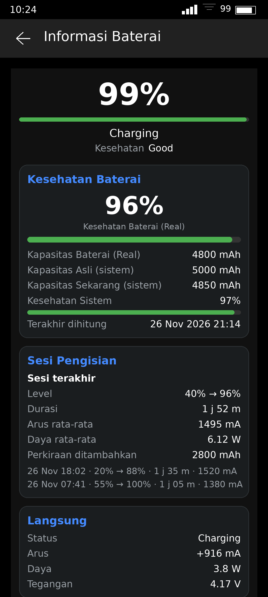
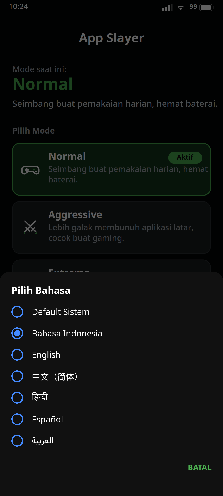
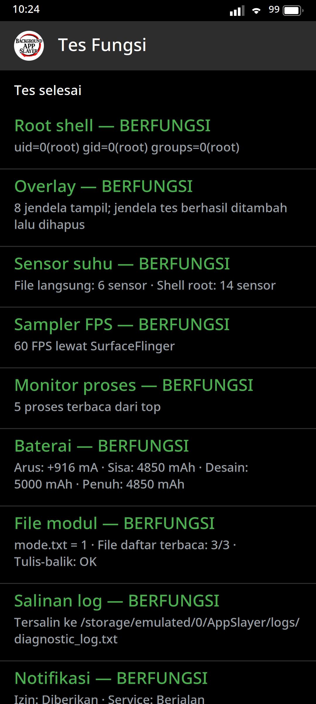
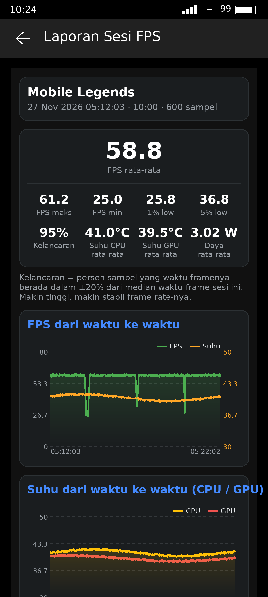

[English](README.md) | **Bahasa Indonesia**

# AppSlayer

**AppSlayer** adalah aplikasi Android ringan yang dibuat untuk menyempurnakan fungsi dari modul *[Background App Slayer](https://github.com/UNKNUW/Background-App-Slayer)*. Aplikasi ini memantau dan mengelola proses latar belakang melalui skrip root, menampilkan status mode dan hasil eksekusi langsung di status bar, serta menyediakan pengaturan daftar langsung di dalam aplikasi tanpa bantuan aplikasi tambahan.

## Fitur Utama

- Tampilan utama baru: mode tampil sebagai kartu, mode yang aktif kelihatan jelas.
- Tiga mode: Normal, Aggressive, dan Extreme, lengkap dengan penjelasan singkat di tiap kartu.
- Notifikasi status di status bar berisi suhu CPU/GPU, baterai, dan RAM, terupdate otomatis.
- Floating monitor: overlay FPS, CPU, RAM, suhu, baterai, arus baterai, dan sinyal yang bisa digeser-geser.
- Info baterai lengkap dengan grafik riwayat baterai 24 jam, rata-rata pemakaian per jam, dan perkiraan sisa waktu.
- Editor daftar bawaan untuk gamelist, whitelist, extreme, dan extrakill.
- Service kembali jalan setelah reboot (bisa diatur).
- Pilihan bahasa Indonesia dan Inggris, bisa diganti langsung di dalam aplikasi.
- Desain ringan dan optimal untuk perangkat dengan spesifikasi rendah.

## Persyaratan

- Android 7.0 sampai Android 16.
- Akses root.
- Modul Background App Slayer sudah terpasang.

## Instalasi

Pasang modulnya dulu, lalu pasang APK AppSlayer dan izinkan akses root saat diminta.

Catatan tanda tangan: build sampai 6.3.0 ditandatangani dengan debug key. Mulai 6.3.1, rilis ditandatangani kunci rilis resmi UNKNUW Projects — kalau kamu dari 6.3.0 atau lebih lama, uninstall sekali dulu, setelah itu update bisa langsung ditimpa.

## Build

APK dibangun otomatis oleh GitHub Actions setiap ada push ke `main`, dan bisa juga dijalankan manual dari tab Actions (workflow "Build APK"). Hasilnya berupa APK debug dan release di bagian artifacts.

Buat yang mau build sendiri di komputer:

```
./gradlew assembleDebug assembleRelease
```

Butuh JDK 17 dan Android SDK 36.

## Catatan Rilis

Riwayat rilis lengkap: [CHANGELOG_ID.md](CHANGELOG_ID.md)

## Preview

<p align="center">
  
  
</p>

<p align="center">
  
  
</p>

<p align="center">
  
  
</p>

## Lisensi

Copyright (C) 2025-2026 UNKNUW Projects

App Slayer adalah perangkat lunak bebas: kamu boleh menyebarluaskan dan/atau mengubahnya di bawah ketentuan GNU General Public License yang diterbitkan oleh Free Software Foundation, baik versi 3 dari lisensi ini, atau (sesuai pilihanmu) versi yang lebih baru.

Program ini disebarluaskan dengan harapan bisa berguna, tapi TANPA JAMINAN APA PUN; bahkan tanpa jaminan tersirat soal KELAYAKAN JUAL atau KESESUAIAN UNTUK TUJUAN TERTENTU. Lihat [GNU General Public License](LICENSE) untuk detailnya.
